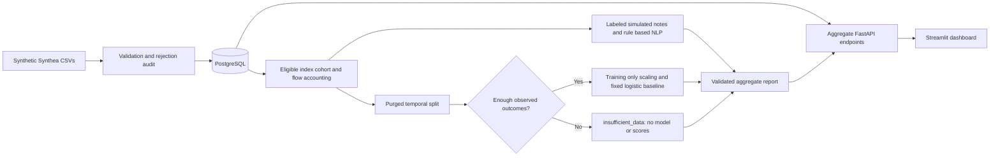
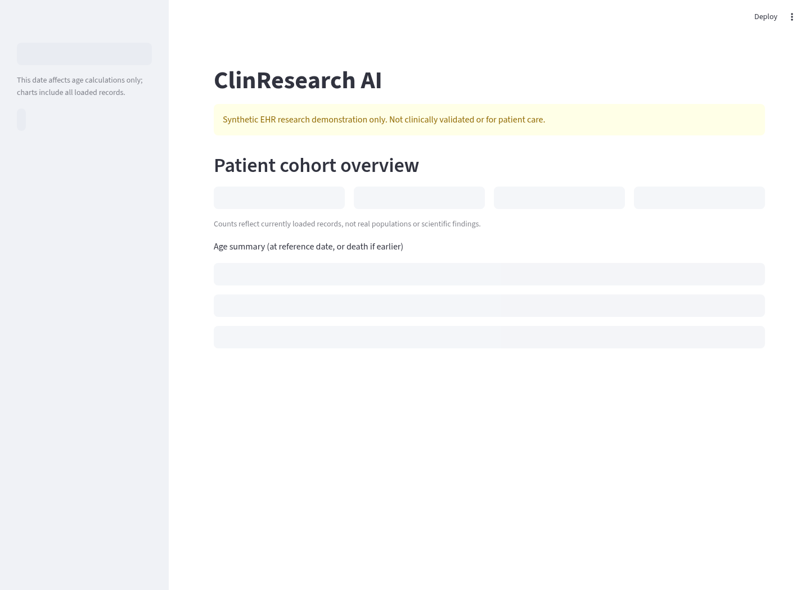

# ClinResearch AI

A locally runnable **Synthetic EHR Research Analytics Platform**, built as a
biomedical research software portfolio project. It validates Synthea CSV exports,
loads normalized PostgreSQL tables, computes descriptive cohort summaries, and
serves a FastAPI API and Streamlit/Plotly dashboard.

**Synthetic data only. Not clinically validated. Not for diagnosis, treatment,
or real patient information.** This is an independent portfolio demonstration,
not a University of Florida product or an endorsed clinical system. An optional
research workflow evaluates a fixed readmission baseline on synthetic records;
its scores do not establish clinical prediction performance.

## Experimental NLP (separate from the clinical-style dashboard)

A fixed synthetic assertion benchmark compares the preserved rules, a CPU TF-IDF
baseline and an optional frozen MiniLM transformer. It reports computed precision,
recall, F1 and errors on a fixed held-out split. The annotations are assistant-authored
and have no independent clinical review: these results are not clinical NLP accuracy.
See [NLP methods, measured results, licensing and commands](docs/nlp-evaluation.md).

## Versioned research runs

```bash
clinresearch analyze --observation-end 2025-01-01 --split-date 2024-01-01 \
  --config configs/adult-return-v1.json --output reports/research-config-v1
```

Choose a fresh output directory. The saved configuration/hash, cohort flow,
class counts and feature distributions make runs inspectable even when the
model status is `insufficient_data`. The supplied configuration tightens sample
requirements; it is not a power analysis. Read the [model card](docs/model-card.md),
[data dictionary](docs/data-dictionary.md), and [study protocol](docs/study-protocol.md).

## Synthetic FHIR R4 imports

FHIR resources and Bundles can feed the existing aggregate APIs and dashboard.
Use a separate database and a stable version label; never mix equivalent CSV and
FHIR exports in the same cohort:

```bash
DATABASE_URL=sqlite:///fhir-demo.db clinresearch ingest-fhir \
  tests/fixtures/fhir/bundle.json --dataset fictional-v1 --synthetic-only \
  --report reports/fhir-demo.json
```

Supports Patient, Encounter, Condition, Observation and MedicationRequest with
local reference validation, duplicate/rejection accounting, deterministic IDs,
source hashes, and idempotent imports. Additive Alembic migrations preserve
existing records. See [field mappings and supported subset](docs/fhir-mapping.md)
and the [milestone roadmap](docs/roadmap.md). Format validation is not proof of
synthetic provenance; no real patient data may be used in the public demo.

## Research software architecture



The API exposes aggregates only. Notes and row-level research artifacts stay in
local output folders. Read the [study protocol](docs/study-protocol.md) before
interpreting any output. The demo is synthetic-only and not clinically validated;
source format validation cannot certify the provenance of arbitrary user imports.
Do not connect a publicly accessible demo to a database containing real records.

| Implemented feature | Verifiable evidence |
| --- | --- |
| Reject negative encounter durations and invalid joins | `tests/test_ingestion.py`, `tests/test_database_api.py` |
| Adult index eligibility, transfer merging, observed return boundary | `tests/test_research.py` |
| Future-record exclusion, purged split, training-only scaling | `tests/test_research.py` |
| Deterministic evaluation and no scores for insufficient outcomes | `tests/test_research.py` |
| Reconciled record/episode/patient flow | `cohort_flow.csv`, report API and regression tests |
| Invalid report HTTP 503 and sanitized CLI database failure | `tests/test_research.py`, `tests/test_cli.py` |
| Live API and dashboard | `scripts/smoke_demo.py`, `scripts/smoke_research.py` |

## Reproduce without rebuilding the application image

The source-mounted Compose configuration used by CI installs hash-locked
packages into a separate dependency volume. It preserves the existing application
image. Run in a clean checkout with free ports 5432, 8000 and 8501:

```bash
# Skip initialization if .env already exists.
python scripts/init_env.py
export COMPOSE_PROJECT_NAME=clinresearch-review
export COMPOSE_FILE=docker-compose.yml:docker-compose.ci.yml
docker compose up --no-build -d --wait --wait-timeout 300
python scripts/smoke_demo.py
docker compose run --rm --no-deps ingest python -m clinresearch.cli analyze \
  --observation-end 2025-01-01 --split-date 2024-01-01 \
  --output /app/reports/research
python scripts/smoke_research.py
```

The fixture has **zero eligible inpatient indices and zero positives**. The
research panel must show `insufficient_data`, without invented scores. Output
folders are never overwritten: for repeat runs choose a fresh directory and set
`RESEARCH_REPORT_PATH` on the API to display it. Use a different Compose project
for isolation; do not remove existing database volumes. In a certificate-proxy
environment, mount the trusted CA bundle read-only into the `deps` service and
set `PIP_CERT` to that path, keeping TLS verification enabled.

## Demo screenshots

Captured from the running source-mounted Compose demo with the committed
fictional fixture. These show software behavior, not research findings.




The [fixture cohort flow](docs/demo-cohort-flow.csv) records all three encounters
as excluded non-inpatient and all three patients as having no inpatient index.
Regenerate it using the analysis command above; each run also emits a flow CSV.

## Milestones

1. **Clinical data platform:** validated Synthea ingestion, normalized SQL tables,
   data-quality audit, API, research dashboard, and automated tests.
2. **NLP and predictive analysis:** clearly labeled simulated discharge notes,
   rule-based concept extraction, explicit 30-day inpatient-return cohort,
   leakage-controlled temporal evaluation, and a saved dashboard report.
   See [research workflow and limitations](docs/research.md) for commands,
   eligibility rules, features, and evaluation definitions. The three-patient
   fixture is too small for model evaluation and reports insufficient data.
3. **Not yet specified.**

## Quick demo with Docker Compose

Requires Docker Engine with Compose v2 and Python 3.11+ for the configuration and
smoke scripts. Run from the repository root:

```bash
python scripts/init_env.py
# Creates ignored .env with a random password; refuses to overwrite an existing file.
docker compose up --build -d --wait
python scripts/smoke_demo.py
```

The one-shot `ingest` service loads the tiny committed fixture, then the API and
dashboard start after readiness checks. The dashboard listens on port **8501**,
the API on **8000**, and interactive API documentation is at path `/docs` on the
API port. Ports are bound to the local machine only. Inspect with:

```bash
docker compose ps
docker compose logs ingest api dashboard
curl --fail 'http://localhost:8000/cohort/summary?as_of=2025-01-01'
```

Expected fixture results, verified by tests: **3 fictional patients, 3 encounters,
3 conditions, 3 observations**; encounter counts January/February/March 2024 are
**2/0/1**; two hypertension occurrences involve two distinct fixture patients;
median completed age at 2025-01-01 is **34**. These are hand-authored test-case
expectations, **not scientific findings or claims about a population**. All
numbers displayed in the dashboard are computed from the database.

```bash
# Reimport to verify idempotency; inspect reports/demo.json for zero new inserts.
docker compose run --rm ingest
# Stop services; retain demo data for next use.
docker compose down
# Optional destructive reset of this demo database only:
docker compose down -v
```

Use `.env.example` if configuring credentials manually. Keep passwords out of
source control and URL-encode special characters in database URLs (the setup
script generates URL-safe hex). Changing a password in `.env` does not change an
already initialized PostgreSQL volume's password. Reports and data are ignored.

### Builds behind a certificate proxy

Normal Docker builds use system certificate trust. In an environment with an
organization-provided CA bundle, supply it as a BuildKit secret without committing
it or disabling TLS verification:

```bash
docker build --secret id=custom_ca,src=/path/to/trusted-ca-bundle.pem -t clinresearch-ai:local .
docker compose up --no-build -d --wait
```

On hosts with read-only Docker configuration directories, set `BUILDX_CONFIG` to
a writable directory outside the checkout. The secret is used only for package
installation; it is not baked into image layers. Lockfile hashes remain enforced.

## Local Python development

Python 3.11+ and PostgreSQL 16 are the supported MVP targets. The lockfile was
resolved for Python 3.11 compatibility and includes development tools. No external
AI API keys or paid services are needed.

```bash
python -m venv .venv
source .venv/bin/activate
python -m pip install --require-hashes -r requirements.lock
python -m pip install --no-deps -e .
python scripts/init_env.py  # skip if .env already exists
set -a; source .env; set +a
docker compose up -d --wait db
clinresearch ingest tests/fixtures/synthea --report reports/demo.json
uvicorn clinresearch.api.app:app --host 127.0.0.1 --port 8000
```

In another activated terminal, load `.env` and run:

```bash
set -a; source .env; set +a
streamlit run src/clinresearch/dashboard/app.py --server.address=127.0.0.1
```

Do not start local servers on ports already occupied by the Compose API/dashboard.
For an empty initialized schema use `clinresearch init-db`. `DATABASE_URL` is
required; it is never inferred from hard-coded credentials. SQLite is available
for lightweight tests (`DATABASE_URL=sqlite:///demo.db`), but PostgreSQL is the
reference database. Empty dashboards show a no-data message.

## Generate actual Synthea CSV exports

The committed CI fixture is hand-authored in Synthea's format. To generate a
larger synthetic cohort, install Java 17+ (Java 21 used during verification),
`curl`, and `sha256sum`, then run:

```bash
scripts/generate_synthea.sh "$PWD/data/synthea" 10
# In the activated Python environment with DATABASE_URL set:
clinresearch ingest data/synthea/csv --report reports/synthea.json
```

The script downloads the official Synthea **v3.3.0** release JAR over HTTPS,
verifies its pinned SHA-256, and refuses to overwrite an existing output folder.
It fixes patient/clinician seeds at **42**, reference date **2024-01-01**, end date
**2025-01-01**, locale and UTC timezone, Florida location, one generator thread,
and full-history CSV output. The source release corresponds to commit
`995cf2fd33e67918d4e33110d9f68ad248002221` in
[synthetichealth/synthea](https://github.com/synthetichealth/synthea/tree/v3.3.0).
Generation can produce deceased overflow records; the requested population is
not a promise about exported patient counts. Fixed inputs and the same generator
and Java runtime are needed for reproducibility.

The generated files remain under ignored `data/`. No real patient data or clinical
notes are included. Only four CSVs are ingested; Synthea may export other files.
Synthea can emit exact duplicate observations, which are reported as rejections.
An import exiting **2** means valid rows were committed but the rejection report
needs review; exit **1** indicates a structural/operational failure. Do not hide
these outcomes with `|| true`. See [validation rules](docs/validation.md).

For a clean generated cohort demo, use a separate database or explicitly reset
the disposable demo volume before ingestion. Upserts never delete rows missing
from later exports, so importing after the tiny fixture combines both cohorts.
The fixture-specific smoke script intentionally fails on a combined dataset.

## API

| Method/path | Computed response |
| --- | --- |
| `GET /health` | Database and expected-schema readiness; HTTP 503 if unavailable |
| `GET /cohort/summary?as_of=2025-01-01` | Counts, demographics, age statistics, latest import quality |
| `GET /encounters/monthly` | UTC month and encounter count, including gaps |
| `GET /conditions/common?limit=10` | Coding system/code, description, occurrence and distinct-patient counts |
| `GET /research/report` | Saved aggregate NLP/model report, or explicit not-run status |

`limit` accepts 1–100. Invalid dates/limits return 422. `as_of` affects ages only;
all records remain in the cohort. The API exposes aggregate data, not patient
records. Full definitions and architecture are in [docs/architecture.md](docs/architecture.md).

## Tests and lint

```bash
ruff check .
ruff format --check .
pytest -q                         # SQLite tests, no downloaded dataset required
# PostgreSQL tests use isolated random schemas, not shared-table deletion:
set -a; source .env; set +a
export TEST_DATABASE_URL="$DATABASE_URL"
pytest -q                         # exercises SQLite AND PostgreSQL
```

Tests cover missing schemas/files, invalid IDs/dates, rejection audit, duplicates,
parent/child joins, foreign keys, transactional rollback, repeated imports,
updates, empty data, aggregation, HTTP validation, and Streamlit rendering against
a live local API. GitHub Actions runs lint and tests with PostgreSQL on Python
3.11 and 3.12. Local execution does not establish that hosted CI has run.

To intentionally update dependencies, use `uv pip compile pyproject.toml --extra dev
--python-version 3.11 --generate-hashes -o requirements.lock`, then reinstall and
rerun checks. Do not edit dependency hashes to bypass verification.

## Project layout

```text
src/clinresearch/
  ingestion/         CSV validation and rejection accounting
  database/          normalized SQLAlchemy models, sessions, atomic loader
  transformations/   Pandas/SQL descriptive summaries
  api/               FastAPI endpoints and Pydantic response contracts
  dashboard/         Streamlit UI with Plotly charts
  cli.py             schema creation and import commands
  research/          simulated notes, cohort definitions, temporal model evaluation
tests/fixtures/      tiny deterministic, fully fictional CSV dataset
docs/               implementation plan, architecture, validation rules
scripts/            local configuration, pinned Synthea generation, HTTP smoke check
```

## Limitations and next steps

Synthetic records do not establish clinical validity, representativeness,
equity, or transportability to any real population. This project does not infer
clinical conclusions, predict real patient outcomes, or claim that simulated text is a real
clinical note. Frequencies are descriptive software outputs, not epidemiologic
estimates. Review missingness and rejected rows before interpreting any summary.

The MVP is intentionally bounded: complete-file ingestion in memory, simple
upserts, no migrations, no terminology service or clinical range checks, and no
authentication or production deployment hardening. Future work could add schema
migrations, streaming ingestion, study-specific cohort definitions, and access
controls after requirements and tests are established. See
[verification evidence](docs/verification.md) for what was actually run.
