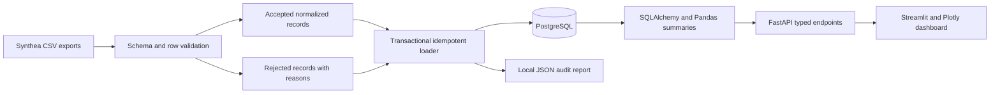

# Architecture and research definitions

`patients` is the demographic parent; `encounters` references one patient.
`conditions` and `observations` each reference one patient and optionally an
encounter. Composite foreign keys ensure an encounter belongs to the same
patient. Stop/death chronology is also constrained in the database.
`import_runs` and `rejected_rows` preserve provenance independently of current
clinical-style table counts. A transaction includes both data and audit inserts.

The API is read-only. The CLI owns schema creation and ingestion. Services do not
silently create an empty database: `/health` requires all expected tables.
Streamlit calls the API with a timeout, caches responses for 30 seconds, and
shows an error rather than substituted values when the API is unavailable.

## Measures

- **Cohort:** all unique patients currently loaded, including those with no
  encounters. There is no inclusion/exclusion study protocol in this MVP.
- **Demographics:** counts by source gender, race, and ethnicity. Blank values are
  `unknown`; categories are not inferred or mapped to clinical concepts.
- **Age:** completed years at `as_of`, or death if earlier. Birth dates after
  that date are missing for age calculations and remain in cohort counts.
  The API defaults to today's date; use `as_of=2025-01-01` for the fixture demo.
  This parameter affects age only, not cohort membership or chart filtering.
- **Monthly encounters:** counts of encounter starts by UTC calendar month;
  missing months between first/last observed months are represented as zero.
- **Common conditions:** occurrence count and distinct-patient count per coding
  system/code. Labels use the lexicographically first description if labels
  differ. Ties sort by system then code. Counts are not prevalence estimates.
- **Quality:** input, accepted, and rejected rows from the latest import,
  inserted/updated counts, cumulative import-run count, and current missing
  demographic counts. Accepted includes unchanged rows on reimport. Rejected
  counts include explicit duplicate suppression; there is no invented quality score.

## Scope and tradeoffs

The importer expects a complete, self-contained export (not arbitrary incremental
child-only CSV batches). Loading is an upsert, not a mirror: rows absent from
later imports remain in the database. Changes to a natural key create new records.
Observation keys include measurement value/unit/type/category to preserve distinct
measurements at the same timestamp; value corrections consequently add a record.
The loader prevents reassignment of an existing encounter to another patient.

The MVP reads CSV files and existing table keys into memory. It is intended for
small portfolio/research demonstrations, not hospital-scale ETL. Schema evolution
requires a future migration tool; `create_all` does not migrate existing tables.
No authentication, role-based access, clinical terminology validation, unit
conversion, clinical plausibility checks, model predictions, or causal analyses
are provided. Bindings are local-only in Compose. Do not deploy with real data.
